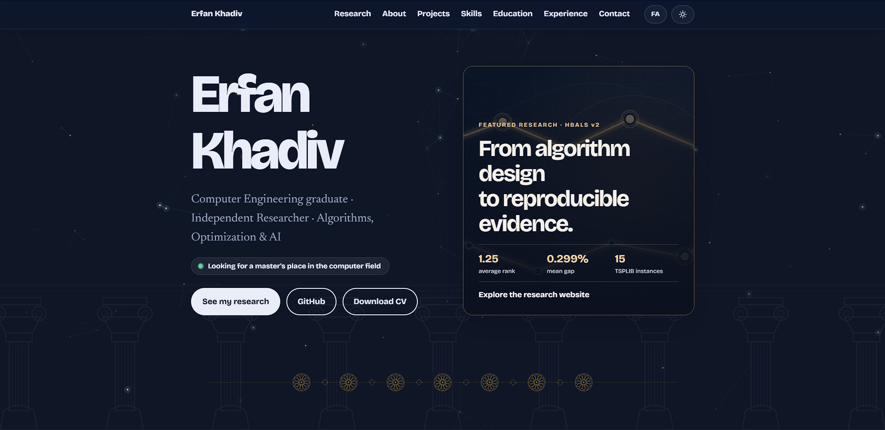
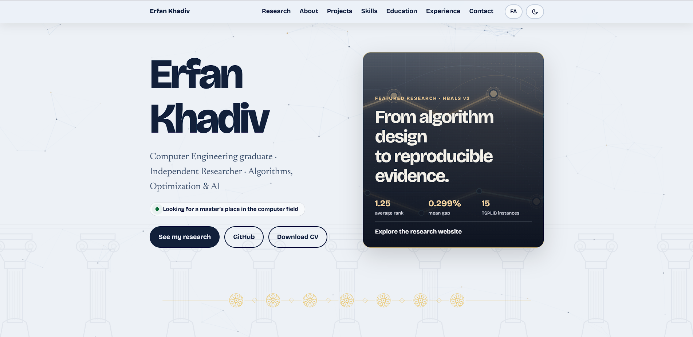
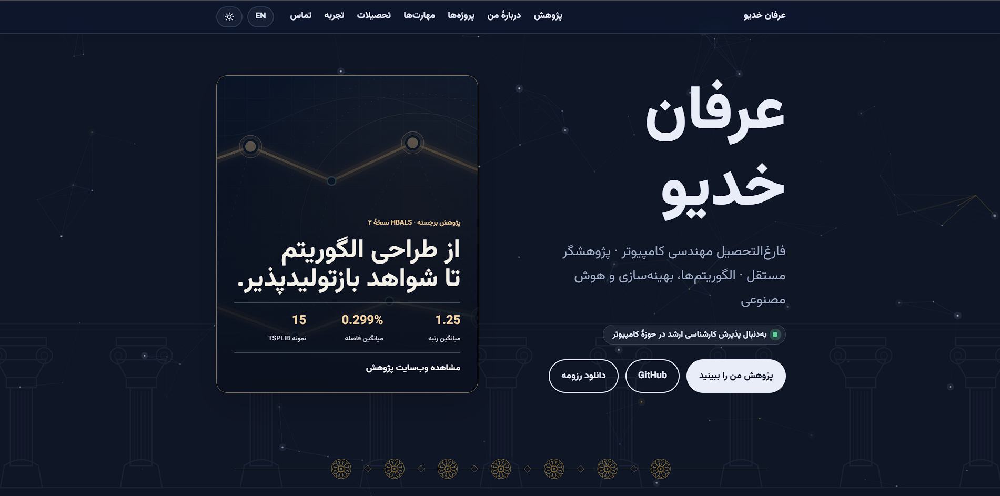

# Erfan Khadiv — Personal Portfolio


-blue)


**Personal portfolio of Erfan Khadiv**, a Computer Engineering graduate interested in algorithms, artificial intelligence, combinatorial optimization and software development.

This is a single-page static website built with plain HTML, CSS and vanilla JavaScript, without frameworks, build tools or external dependencies.

The website supports **English and Persian (RTL)**, as well as **dark and light themes**. It presents my academic background, research, selected projects, technical skills, experience and contact information.

**[Visit the Portfolio → erfankhadiv.github.io](https://erfankhadiv.github.io/)**

[](https://erfankhadiv.github.io/)

---

## Contents

- [Preview](#preview)
- [Sections](#sections)
- [Featured Research: HBALS](#featured-research-hbals)
- [Features](#features)
- [Concepts and Skills Covered](#concepts-and-skills-covered)
- [Project Structure](#project-structure)
- [Setup and Running](#setup-and-running)
- [Deployment](#deployment)
- [Related Projects](#related-projects)
- [License](#license)

## Preview

| Dark Mode | Light Mode |
|:---:|:---:|
| [](docs/screenshots/Dark_Mode_En.png) | [](docs/screenshots/Light_Mode_En.png) |

### Persian Version (RTL)

[](docs/screenshots/Dark_Mode_Fa.png)

## Sections

| Section | Description |
|---|---|
| Hero | Personal introduction, professional tagline and featured research |
| Research | Overview of my research projects, including HBALS and Li-Fi |
| About | Academic background, introduction and research interests |
| Projects | Selected software projects with links to source code and live applications |
| Skills | Programming languages, tools and technical competencies |
| Education | Academic qualifications, achievements and IELTS |
| Experience | Professional and practical experience |
| Contact | Email and professional social links |

## Featured Research: HBALS

### HBALS — Hybrid Bees Algorithm with 2-opt Local Search

HBALS is my flagship research project: a hybrid metaheuristic for the Travelling Salesman Problem (TSP), combining the Bees Algorithm with 2-opt local search.

The portfolio introduces the project and directs visitors to its dedicated research website.

**Explore HBALS:**

[](https://erfankhadiv.github.io/HBALS-TSP/)
[](https://github.com/ErfanKhadiv/HBALS-TSP)

The dedicated website provides:

- Research background and algorithm design.
- Experimental methodology and benchmark comparisons.
- Convergence visualizations and statistical analysis.
- Ablation study and component analysis.
- An interactive browser-based algorithm demo.
- Source code, benchmark instances and reproducibility information.
- Preprint and citation information.

**[Visit the HBALS Research Website and Try the Live Demo →](https://erfankhadiv.github.io/HBALS-TSP/)**

## Features

- **Bilingual interface:** English and Persian, with a complete right-to-left layout.
- **Theme switching:** Dark and light modes, with the selected preference remembered between visits.
- **Responsive design:** Layout adapts to desktop, tablet and mobile screens.
- **Interactive navigation:** A frosted-glass navigation menu highlights the currently viewed section.
- **Research showcase:** Dedicated presentation of research projects with links to their full documentation.
- **Project showcase:** Selected software projects with repository and live application links.
- **CV access:** Direct access to my curriculum vitae.
- **Back-to-top button:** Convenient navigation through the page.
- **Keyboard accessibility:** Keyboard-friendly navigation and controls.

## Concepts and Skills Covered

- **Front-end fundamentals:** Semantic HTML5, CSS3, responsive layouts and vanilla JavaScript.
- **Internationalization:** Bilingual content and right-to-left layout for Persian.
- **Theme management:** Dark/light switching and persistent user preferences.
- **Interaction design:** Scroll-aware navigation, responsive components and accessible controls.
- **Research presentation:** Structuring technical projects, research findings and academic information for the web.
- **Project integration:** Connecting a personal portfolio to independent research websites and GitHub repositories.
- **Deployment:** Static website hosting with GitHub Pages.

## Project Structure

```text
ErfanKhadiv.github.io/
├── index.html              # Main page: content, styles and scripts
├── assets/
│   ├── css/                # Stylesheets
│   ├── js/                 # JavaScript functionality
│   └── img/                # Images, thumbnails and visual assets
├── docs/
│   └── screenshots/        # Screenshots used in this README
├── icon.svg                # Site icon
├── favicon.ico
├── apple-touch-icon.png
├── icon-192.png
├── icon-512.png
├── .nojekyll               # GitHub Pages configuration
└── README.md
```

## Setup and Running

No installation, package manager or build process is required.

Clone the repository:

```bash
git clone https://github.com/ErfanKhadiv/ErfanKhadiv.github.io.git
cd ErfanKhadiv.github.io
```

You can open `index.html` directly in a browser or start a local development server:

```bash
python3 -m http.server
```

Then visit:

```text
http://localhost:8000
```

## Deployment

The website is hosted using **GitHub Pages**.

To deploy:

1. Open the repository settings on GitHub.
2. Navigate to **Settings → Pages**.
3. Select **Deploy from a branch**.
4. Choose the `main` branch and `/ (root)` directory.
5. Save the configuration.

The website is available at:

**https://erfankhadiv.github.io/**

## Related Projects

| Project | Description |
|---|---|
| [**HBALS-TSP — Source Code**](https://github.com/ErfanKhadiv/HBALS-TSP) | Algorithm implementation, benchmark instances, experimental results and research documentation. |
| [**HBALS — Official Website**](https://erfankhadiv.github.io/HBALS-TSP/) | Dedicated research website featuring methodology, results, statistical analysis and an interactive live demo. |
| [**Workfolio**](https://github.com/ErfanKhadiv/Workfolio) | Browser-based resume builder with customizable templates and AI-powered job matching. |
| [**Kouman**](https://github.com/ErfanKhadiv/Kouman) | React-based bilingual e-commerce front end. |
| [**LiFi-Report**](https://github.com/ErfanKhadiv/LiFi-Report) | Research report on Li-Fi wireless communication and its technical challenges. |

## License

All rights reserved.

The source code, personal content, photographs and certificates in this repository may not be redistributed or reused without permission, unless otherwise specified.
