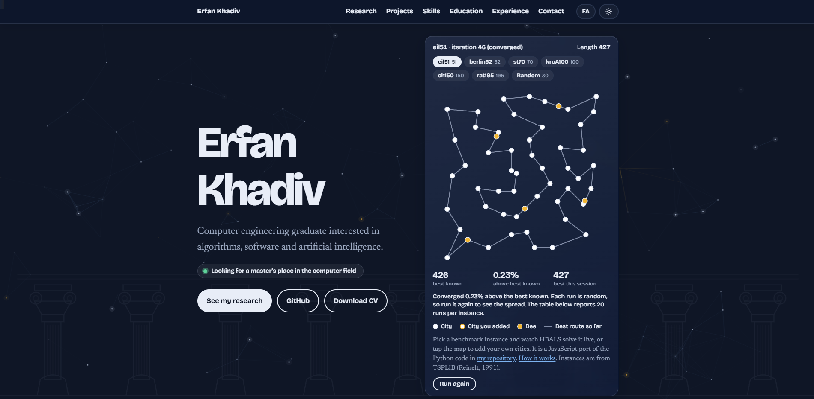
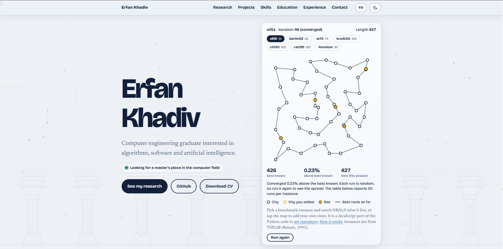
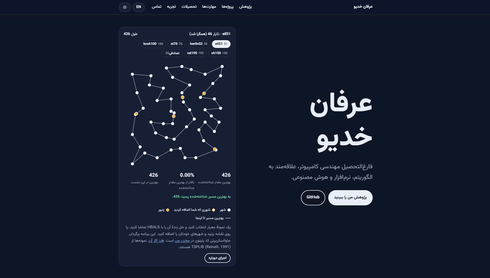

<div align="center">

# Erfan Khadiv, portfolio

Computer engineering graduate interested in algorithms, software and artificial intelligence.

[](https://erfankhadiv.github.io/)
[](https://github.com/ErfanKhadiv)

<a href="https://erfankhadiv.github.io/">
  
</a>

</div>

## About this site

A personal portfolio built as one static page: plain HTML, CSS and a little JavaScript. There is no framework, no build step and nothing to install. It is available in **English and Persian (right-to-left)** and in **dark and light mode**.

At the top of the page, an animated map runs HBALS, my Traveling Salesman Problem algorithm, live in the browser.

## Preview

| Dark mode | Light mode |
|---|---|
|  |  |

| Persian (RTL) |
|---|
|  |

## Sections

- **Hero:** name, a short tagline and the live HBALS map.
- **Research:** the HBALS project, what it solves and how it performed.
- **About:** a short introduction and areas of interest.
- **Projects:** selected work with demos and code.
- **Skills:** languages, tools and topics.
- **Education:** degree, IELTS and certificates.
- **Experience:** an internship story.
- **Contact:** ways to get in touch.

## Features

- Dark mode by default, with a light mode toggle that is remembered
- English / Persian switch with a full right-to-left layout
- Frosted-glass menu that highlights the section you are viewing
- Frosted-glass cards, with a soft spotlight that follows the pointer on hover
- Click any card or photo to open it as a focused glass card; Esc, the close button or a click outside closes it
- Certificates and "Learning in practice" laid out as framed cards with verify links and captions
- Downloadable CV (PDF) from the hero and the contact section
- University alumni rank certificate shown as a zoomable card, with personal numbers and QR codes blurred inside the image file
- Live constellation background: drifting stars that link up like a route, lean toward the pointer, and are crossed by an occasional shooting star (static when reduced motion is on, paused in hidden tabs)
- Reading-progress bar at the top of the page
- Status pill in the hero, a copy-email button in the contact section, and a gentle reveal as sections scroll into view
- Structured data (schema.org Person) and a canonical link for search engines
- Back-to-top button
- Live, interactive HBALS demo on real TSPLIB benchmark instances
- Responsive layout and keyboard-friendly controls

## Project structure

```
index.html          the whole page (styles, content and scripts)
assets/img/         thumbnails, certificates and photos
assets/Khadiv_Erfan_CV.pdf   the downloadable CV
docs/screenshots/   preview images used in this README and in link previews
icon.svg, favicon.ico, apple-touch-icon.png, icon-192.png, icon-512.png   site icons
.nojekyll           tells GitHub Pages to serve the files as they are
```

## Run locally

Open `index.html` in a browser, or run:

```bash
python3 -m http.server
```

then visit `http://localhost:8000`.

## Deploy

Hosted with GitHub Pages: Settings → Pages → Deploy from a branch → `main` / root.

## Related

- [HBALS-TSP](https://github.com/ErfanKhadiv/HBALS-TSP): code, data and paper for the algorithm shown on the site.

## License

All rights reserved. The text, photos and certificates on this site are personal content and may not be reused without permission.
